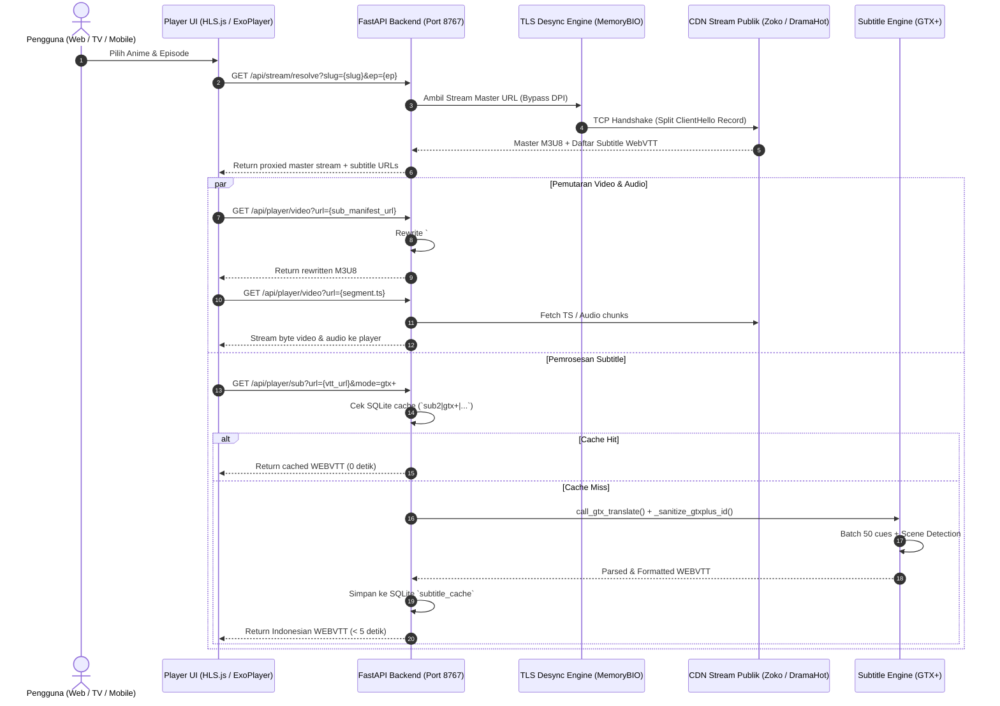

# PROJECT_MAP.md — Peta Arsitektur & Indeks Navigasi Teknis Tatap

> [!IMPORTANT]
> **DIREKTIF BACAAN WAJIB BAGI SEMUA AI AGENT (ANTIGRAVITY / GEMINI / CLAUDE / CURSOR / COPILOT):**
> Sebelum memulai perencanaan (*planning*), investigasi, atau iterasi implementasi kode apa pun pada repositori ini:
> 1. Baca **[`AGENTS.md`](file:///home/b-ict/tatap/AGENTS.md)** (Pedoman Master Directives, SOP SemVer 2.0.0, Aturan Rilis 4 Aset Resmi, dan Blacklist Hentai).
> 2. Baca **[`PROJECT_MAP.md`](file:///home/b-ict/tatap/PROJECT_MAP.md)** (Dokumen ini — Peta Topologi Berkas, Paritas Ganda Chaquopy, dan Indeks Simbol Fungsi Utama).
>
> Dengan membaca kedua dokumen ini terlebih dahulu, agent dapat langsung mengeksekusi tugas tanpa membuang waktu dan putaran *tool call* untuk penelusuran manual (*zero search overhead*).

---

## 0. AI Agent Decision Matrix (Tabel Aksi Cepat)

Gunakan tabel ini sebagai panduan instan: cari skenario tugas Anda di kolom pertama, buka berkas yang relevan, perhatikan jebakan (*gotchas*), dan jalankan perintah verifikasi.

| Kategori Tugas | Berkas Utama | Berkas Pasangan Wajib (Parity) | Jebakan Kritis (Gotchas) | Perintah Verifikasi |
| :--- | :--- | :--- | :--- | :--- |
| **Scraper & Stream Resolver** | [`backend/api/hianime.py`](file:///home/b-ict/tatap/backend/api/hianime.py)<br>[`backend/api/otakudesu.py`](file:///home/b-ict/tatap/backend/api/otakudesu.py) | [`android/app/src/main/python/backend/api/hianime.py`](file:///home/b-ict/tatap/android/app/src/main/python/backend/api/hianime.py)<br>[`android/app/src/main/python/backend/api/otakudesu.py`](file:///home/b-ict/tatap/android/app/src/main/python/backend/api/otakudesu.py) | Jangan gunakan `curl_cffi` langsung di Android Chaquopy. Gunakan fallback otomatis `httpx` dan `tls_desync_request`. Validasi season number & title match saat catalog fallback! | `pytest tests/test_episodes.py` |
| **Subtitle Engine & Leksikon** | [`backend/api/translate.py`](file:///home/b-ict/tatap/backend/api/translate.py) | [`android/app/src/main/python/backend/api/translate.py`](file:///home/b-ict/tatap/android/app/src/main/python/backend/api/translate.py) | Pertahankan backward-compatibility cache key `sub2\|gtx+\|` dan fallback pembacaan `sub2\|aigtx\|`. Gunakan endpoint pool `clients5.google.com` (hindari parameter usang `client=gtx`). | `pytest tests/test_translate.py` |
| **M3U8 Rewrite & Sub-Track Proxy** | [`backend/main.py`](file:///home/b-ict/tatap/backend/main.py) | [`android/app/src/main/python/backend/main.py`](file:///home/b-ict/tatap/android/app/src/main/python/backend/main.py) | Seluruh sub-manifest video dan audio (`#EXT-X-MEDIA:TYPE=AUDIO,... URI="..."`) WAJIB ditulis ulang ke endpoint proxy `/api/player/video?url=...` agar tidak memicu 404 pada stream demuxed (seperti ZokoAnime). | `pytest tests/test_prefetch.py` |
| **Networking & Anti-DPI** | [`backend/api/desync.py`](file:///home/b-ict/tatap/backend/api/desync.py) | [`android/app/src/main/python/backend/api/desync.py`](file:///home/b-ict/tatap/android/app/src/main/python/backend/api/desync.py) | Fragmentasi TLS record 1-byte ClientHello via `ssl.MemoryBIO` dan standard TCP `SOCK_STREAM` (bukan raw socket OS). Proteksi DoH via `1.1.1.1` & `8.8.8.8`. | `python3 -c "from backend.api.desync import tls_desync_connect; print(tls_desync_connect('hls.dramahot.top'))"` |
| **UI Web Desktop & Controls** | [`frontend/js/app.js`](file:///home/b-ict/tatap/frontend/js/app.js)<br>[`frontend/css/style.css`](file:///home/b-ict/tatap/frontend/css/style.css)<br>[`frontend/index.html`](file:///home/b-ict/tatap/frontend/index.html) | - | Dual-layer subtitle rendering: sinkronisasi kustom overlay `#pm-subs-overlay` dan native `VTTCue` (`video::cue`) wajib aktif saat mode fullscreen `.ambient-stage`. | Buka browser di `http://127.0.0.1:8767` |
| **Android Mobile & Android TV UI** | [`android/app/src/main/java/id/tatap/app/PlayerActivity.java`](file:///home/b-ict/tatap/android/app/src/main/java/id/tatap/app/PlayerActivity.java)<br>[`MainActivity.java`](file:///home/b-ict/tatap/android/app/src/main/java/id/tatap/app/MainActivity.java) | [`TvFocusHelper.java`](file:///home/b-ict/tatap/android/app/src/main/java/id/tatap/app/TvFocusHelper.java) | Gunakan *continuous float accumulator* (`currentVolumeFraction`) pada gesture volume mobile (hindari integer truncation). Semua UI interaktif wajib mendukung remote D-Pad TV via `TvFocusHelper`. | `cd android && ./gradlew assembleDebug` |
| **In-App Update & Android Installer** | [`android/app/src/main/java/id/tatap/app/AppUpdateManager.java`](file:///home/b-ict/tatap/android/app/src/main/java/id/tatap/app/AppUpdateManager.java)<br>[`dialog_app_update.xml`](file:///home/b-ict/tatap/android/app/src/main/res/layout/dialog_app_update.xml) | [`backend/main.py`](file:///home/b-ict/tatap/backend/main.py) (`check_update`) | Tombol aksi unduh & pasang APK (`btn_update_now`) wajib selalu ada dan berada tepat di bawah tampilan changelog. DILARANG memaksa buka browser eksternal! | `pytest tests/test_in_app_update.py` |
| **Packaging Desktop (Linux/Win)** | [`tools/build_linux_appimage.py`](file:///home/b-ict/tatap/tools/build_linux_appimage.py)<br>[`tools/build_windows_portable.py`](file:///home/b-ict/tatap/tools/build_windows_portable.py) | [`launcher/main.go`](file:///home/b-ict/tatap/launcher/main.go) | Gunakan isolasi wheel murni `win_amd64` python 311 (cegah tabrakan `pydantic-core`). Di Linux, `AppRun` memprioritaskan Chromium app mode. | `python3 tools/build_linux_appimage.py`<br>`python3 tools/build_windows_portable.py` |
| **Versi & Rilis SemVer 2.0.0** | [`VERSION`](file:///home/b-ict/tatap/VERSION)<br>[`CHANGELOG.md`](file:///home/b-ict/tatap/CHANGELOG.md) | Utilitas atomik | DILARANG mengedit versi manual satu per satu! Wajib gunakan `bump_version.py` dan perbarui `CHANGELOG.md` dengan alasan kenaikan nomor versi. | `python3 tools/bump_version.py <patch\|minor\|major>`<br>`pytest tests/test_semver.py` |
| **Aset Rilis GitHub** | [`dist/`](file:///home/b-ict/tatap/dist/) | GitHub Release Tag | Rilis publik **HANYA BOLEH MEMUAT 4 ASET RESMI**. Segera hapus file mentah (`app-release.apk`, `app-debug.apk`) via `gh release delete-asset`. | `gh release view v<VERSION>` |
| **Download Buttons README.md** | [`README.md`](file:///home/b-ict/tatap/README.md) | GitHub Public Release | Tautan unduhan di README.md WAJIB selalu mengarah ke versi rilis publik terbaru (`tatap-release-v<LATEST_PUBLIC>.apk`). JANGAN arahkan ke versi DRAFT (memicu error 404). Gunakan `python3 tools/bump_version.py --sync-readme` hanya setelah rilis publik. | `curl -sIL <url> \| grep HTTP/` |

---

## 1. Peta Pohon Direktori Lengkap & Anotasi Berkas

```
tatap/
├── AGENTS.md                          # [MASTER DIRECTIVE] SOP Paten SemVer, Signed APK, Strict 4 Assets, & Blacklist
├── GEMINI.md -> AGENTS.md             # Symlink directive untuk Google Gemini CLI / Agent
├── agent.md -> AGENTS.md              # Symlink directive untuk Claude / generic agent
├── PROJECT_MAP.md                     # [FILE INI] Peta topologi, data pipeline, & indeks simbol fungsi
├── README.md                          # Dokumentasi publik (User-facing, down-to-earth, non-overclaim)
├── CHANGELOG.md                       # Log perubahan terstruktur mengikuti format Keep a Changelog
├── VERSION                            # Single source of truth nomor versi SemVer (misal: 2.4.2)
│
├── backend/                           # BACKEND ENGINE (Desktop & Sumber Utama)
│   ├── main.py                        # Entrypoint FastAPI, Uvicorn server, proxy stream, subtitle, & routing API
│   ├── config.py                      # Konfigurasi port (8767), host (127.0.0.1), direktori database & cache
│   ├── version.py                     # Definisi variabel versi Python __version__ = "X.Y.Z"
│   ├── database/                      # Modul persistensi SQLite lokal (aiosqlite)
│   │   └── __init__.py                # Handler tabel history, bookmarks, settings, subtitle_cache, & slug_map
│   └── api/                           # Modul Scraper & Networking
│       ├── anilist.py                 # Client GraphQL AniList (metadata anime, search, trending, seasonal)
│       ├── hianime.py                 # Scraper HiAnime / MegaCloud / ZokoAnime / RapidCloud stream resolver
│       ├── otakudesu.py               # Scraper Otakudesu (fallback stream & anime sub Indo)
│       ├── desync.py                  # TLS ClientHello desynchronization (DPI bypass) & DoH resolver
│       └── translate.py               # Mesin terjemahan subtitle multi-tier (GTX+, AI Fansub BYOK, Google RPC)
│
├── frontend/                          # FRONTEND WEB DESKTOP (Zero-build Vanilla JS & CSS)
│   ├── index.html                     # Single-page interface, stage layout, modal sheets, & prompt terminal
│   ├── favicon.ico / assets/          # Ikon aplikasi multi-ukuran (192px, 512px)
│   ├── css/
│   │   └── style.css                  # Dark cyberpunk aesthetic, ambient glow, CRT scanline mode, responsive
│   └── js/
│       ├── app.js                     # State management, HLS.js video playback, custom subtitle overlay
│       ├── api.js                     # Wrapper fetch HTTP API ke localhost backend
│       └── term.js                    # In-app terminal command parser (:command / /command)
│
├── android/                           # NATIVE ANDROID & ANDROID TV APP
│   ├── build.gradle                   # Konfigurasi root gradle (Chaquopy plugin 15.0.1, AGP 8.2.2)
│   ├── keystore/
│   │   └── release.jks                # Production Release Keystore (v1 & v2 Multi-Scheme Signing)
│   └── app/
│       ├── build.gradle               # 16KB packaging (useLegacyPackaging), Chaquopy deps, & signingConfigs
│       └── src/main/
│           ├── AndroidManifest.xml    # Deklarasi permission, Leanback launcher, TV banner, & nativeLibs
│           ├── java/id/tatap/app/     # Java Native UI Code
│           │   ├── MainActivity.java  # Beranda (Airing, Seasonal, Schedule 3-hari, History, Terminal command)
│           │   ├── DetailActivity.java# Detail info, rating, sinopsis, episode list, & selector range
│           │   ├── PlayerActivity.java# Media3 ExoPlayer, gesture volume/bright, D-Pad remote, subtitle dialog
│           │   ├── AnimeAdapter.java  # RecyclerView adapter kartu poster anime
│           │   ├── ImageLoader.java   # Asynchronous bitmap downloader & LruCache (zero external dependency)
│           │   └── TvFocusHelper.java # Deteksi isTv(), animasi scale focus 1.05x, border glow, & remote handling
│           └── python/                # CHAQUOPY EMBEDDED PYTHON BACKEND (Salinan Paritas)
│               ├── server_launcher.py # Thread launcher Uvicorn di dalam JVM Android process (port 8767)
│               └── backend/           # Salinan 100% IDENTIK dengan folder backend/ di root
│                   ├── main.py, config.py, version.py, database/, api/
│
├── launcher/                          # WINDOWS PORTABLE LAUNCHER (Go Native)
│   ├── main.go                        # Native Go entrypoint: lifecycle backend python, Edge WebView2 window
│   ├── icon.ico                       # Ikon binary Windows
│   └── winres/                        # Windows resource manifest & metadata version info (winres.json)
│
├── linux/                             # LINUX APPIMAGE INTEGRATION
│   ├── AppRun                         # Bash launcher AppImage: deteksi Chromium app mode (--app) / xdg-open
│   └── tatap.desktop                  # Desktop entry XDG standar
│
├── tools/                             # AUTOMATION & PACKAGING SCRIPTS
│   ├── bump_version.py                # Utilitas atomik sinkronisasi SemVer 2.0.0 ke seluruh berkas proyek
│   ├── build_linux_appimage.py        # Builder AppImage mandiri (membungkus CPython 3.11 standalone)
│   └── build_windows_portable.py      # Builder Windows Portable zip (membungkus Python 3.11 embeddable)
│
├── tests/                             # AUTOMATED TEST SUITE (Pytest)
│   ├── test_semver.py                 # Audit kepatuhan SemVer 2.0.0 di 5+ lokasi berkas proyek
│   ├── test_translate.py              # Unit test parser VTT, provider detection, leksikon, & sanitasi teks
│   ├── test_prefetch.py               # Unit test deduplikasi in-flight subtitle job prefetch
│   ├── test_episodes.py               # Verifikasi parser dan fallback daftar episode
│   ├── test_schedule.py               # Verifikasi endpoint jadwal rilis 3-hari (WIB)
│   └── test_relations.py              # Verifikasi relasi sekuel/prekuel katalog
│
└── dist/                              # DIREKTORI OUTPUT BINARY RILIS (Gitignored)
    ├── Tatap-x86_64.AppImage          # Binary resmi Linux AppImage (~58 MB)
    ├── tatap-windows-x64-portable.zip # Arsip resmi Windows Portable (~26 MB)
    └── android/
        ├── tatap-release-v<VER>.apk   # Official Signed Mobile APK (~35 MB)
        └── tatap-tv-release-v<VER>.apk# Official Signed Android TV APK (~35 MB)
```

---

## 2. Aturan Emas Paritas Ganda (Chaquopy Dual-Copy Parity)

> [!CAUTION]
> **PANTANGAN MUTLAK UNTUK BACKEND:**
> Repositori memiliki **DUA lokasi kode backend**:
> 1. `backend/` — Digunakan oleh Web Desktop, Windows Portable, dan Linux AppImage.
> 2. `android/app/src/main/python/backend/` — Dibundel oleh Chaquopy ke dalam APK Android Mobile dan TV.
>
> **SETIAP KALI ANDA MEMODIFIKASI KODE DI `backend/`, ANDA WAJIB MENYALIN PERUBAHAN KE `android/app/src/main/python/backend/`!**

### Perintah Cepat Sinkronisasi Paritas:
```bash
cp -r backend/api/* android/app/src/main/python/backend/api/
cp backend/main.py android/app/src/main/python/backend/main.py
cp backend/version.py android/app/src/main/python/backend/version.py
```

---

## 3. Indeks Simbol & Fungsi Kunci (Symbol Table)

Agent tidak perlu melakukan `grep` berulang kali. Gunakan indeks referensi fungsi vital berikut:

### Backend ([`backend/main.py`](file:///home/b-ict/tatap/backend/main.py))
- `resolve_stream_auto(slug, episode_num)`: Menyelesaikan stream master M3U8 dari sumber utama (HiAnime) dengan failover ke Otakudesu.
- `_rewrite_m3u8_content(content, base_url)`: Menulis ulang seluruh URL segmen TS, sub-manifest video, dan audio track (`#EXT-X-MEDIA:TYPE=AUDIO`) agar diarahkan melalui proxy lokal.
- `proxy_video(url, referer)`: Endpoint `/api/player/video` — streaming segmen video/audio dengan auto-retry dan bypass TLS desync.
- `proxy_sub(url, referer, lang, mode)`: Endpoint `/api/player/sub` — mengunduh WebVTT dan mengorkestrasi translasi multi-tier.
- `get_schedule()`: Endpoint `/api/schedule` — menghasilkan jadwal anime 3-hari (Kemarin, Hari Ini, Besok) terfilter zona waktu WIB.

### Jaringan Anti-DPI ([`backend/api/desync.py`](file:///home/b-ict/tatap/backend/api/desync.py))
- `tls_desync_connect(host, port, timeout)`: Membuka TCP stream socket standard (`SOCK_STREAM`) dan membagi TLS ClientHello menjadi 2 record (1 byte pertama di record 1, sisanya di record 2 dengan jeda 40ms via `ssl.MemoryBIO`).
- `tls_desync_request(url, headers, timeout)`: Eksekutor HTTP GET langsung via socket desync untuk domain yang terblokir DPI ISP (misal: `hls.dramahot.top`).
- `_resolve_host(host)`: Multi-tier DNS resolver (Cache -> Local System DNS -> DoH Cloudflare `1.1.1.1` -> DoH Google `dns.google` -> Hardcoded IP).

### Mesin Subtitle ([`backend/api/translate.py`](file:///home/b-ict/tatap/backend/api/translate.py))
- `call_gtx_translate(cues, src, tgt, mode)`: Mesin GTX+ berkecepatan tinggi memanfaatkan pool RPC `clients5.google.com` (konkurensi 2–3 pekerja, HTML tag preservation, durasi < 5s per episode).
- `_sanitize_gtxplus_id(text)`: Scene detector adaptif (membedakan adegan formal/militer vs percakapan kasual) yang menerapkan ratusan leksikon dialog santai fansub (*nggak, udah, banget, maksudmu apa, mau gimana lagi*).
- `call_openai_translate(cues, src, tgt, apikey, model, apiurl)`: Mesin AI Fansub BYOK multi-provider (Ollama, Gemini, Groq, OpenAI, OpenRouter) dengan format batched ID `N|text` dan rotasi model otomatis.

### Android Native Player ([`PlayerActivity.java`](file:///home/b-ict/tatap/android/app/src/main/java/id/tatap/app/PlayerActivity.java))
- `initExoPlayer()`: Konfigurasi Media3 ExoPlayer dengan HLS media source dan `SubtitleConfiguration`.
- `applySubtitleSize()`: Penyesuaian ukuran font dinamis: Skala Mobile (14sp–36sp) vs Skala Android TV (18sp–42sp) dengan `lineSpacingMultiplier="1.2"`.
- `dispatchKeyEvent(KeyEvent event)`: Menangkap interaksi remote TV D-Pad (`KEYCODE_DPAD_CENTER`, `LEFT`, `RIGHT`, `UP`, `DOWN`, `MEDIA_PLAY_PAUSE`).
- `TvFocusHelper.java`: Deteksi otomatis perangkat TV (`isTv()`), animasi scale-up fokus `1.05x`, dan outline neon border cyan.

---

## 4. Alur Data Streaming & Subtitle (Data Pipeline)



---

## 5. Skema Basis Data SQLite Lokal (`anime.db`)

Basis data lokal dikelola secara asinkron via `aiosqlite` di [`backend/database/__init__.py`](file:///home/b-ict/tatap/backend/database/__init__.py).

| Nama Tabel | Kolom Utama | Fungsi & Keterangan |
| :--- | :--- | :--- |
| **`history`** | `slug` (PK), `title`, `poster`, `episode`, `ep_title`, `position`, `duration`, `updated_at` | Menyimpan riwayat tontonan terakhir dan posisi detik pemutaran (resume watching). |
| **`bookmarks`** | `slug` (PK), `title`, `poster`, `created_at` | Menyimpan daftar anime favorit yang ditandai pengguna. |
| **`settings`** | `key` (PK), `value` | Menyimpan preferensi pengguna (resolusi default, track mode subtitle, API key LLM pribadi). |
| **`subtitle_cache`** | `key` (PK), `content`, `updated_at` | Cache teks WEBVTT hasil translasi untuk menghemat kuota dan mempercepat pemutaran. |
| **`slug_map`** | `ani_id` (PK), `slug`, `title`, `updated_at` | Pemetaan relasi ID AniList ke slug HiAnime/Otakudesu yang telah divalidasi. |

### Konvensi Prefix Cache Key Subtitle:
- `sub2|gtx+|<hash>`: Terjemahan mesin GTX+ terkini (TTL 7 hari).
- `sub2|aigtx|<hash>`: Format legacy AIGTX (didukung untuk fallback baca).
- `sub2|llm|<hash>`: Terjemahan halus AI Fansub LLM (TTL 30 hari).
- `sub2|raw|<hash>`: Subtitle mentah asli dari sumber video (TTL 7 hari).

---

## 6. Daftar Anti-Pattern & Pantangan Mutlak (Gotchas)

1. ❌ **Jangan Pasang Library C-Extension di Chaquopy Tanpa Wheel:** Chaquopy mengompilasi Python di Android. Pustaka seperti `curl_cffi` atau `pydantic>=2` (berbasis Rust) tidak memiliki wheel yang kompatibel dan akan menyebabkan kompilasi Gradle atau startup runtime crash.
2. ❌ **Jangan Lakukan Fallback Buta ke `res[0]` pada Katalog:** Saat mencocokkan AniList ke HiAnime/Otakudesu, selalu validasi `_extract_season_num()` dan `_is_title_match()`. Fallback buta akan mengotori tabel `slug_map` permanen.
3. ❌ **Jangan Hapus Filter Konten Hentai:** Kebijakan zero-tolerance blacklist hentai (`_is_hentai`) wajib dijaga pada seluruh endpoint scraper dan antarmuka pencarian.
4. ❌ **Jangan Rilis APK Unsigned atau Mentah:** Rilis GitHub publik wajib strictly 4 aset resmi dan ditandatangani via `release.jks` dengan skema signature v2. Segera hapus file bawaan CI `app-release.apk`.
5. ❌ **Jangan Gunakan Integer Truncation pada Gesture Volume:** Pada `PlayerActivity.java`, selalu gunakan float accumulator `currentVolumeFraction` agar swipe tidak macet pada Android modern.
6. ❌ **Jangan Paksa Buka Browser Eksternal untuk In-App Update:** Setiap dialog atau alur update Android wajib memiliki tombol aksi langsung (`btn_update_now`) untuk mengunduh streaming APK dan menginstalnya via `FileProvider`/`PackageInstaller`. Tombol perbarui wajib selalu berada tepat di bawah wadah teks changelog/catatan rilis.

---

## 7. Indeks Perintah Testing, Build & Release

```bash
# 1. Menjalankan Unit Tests Lengkap
pytest tests/

# 2. Verifikasi Kepatuhan SemVer 2.0.0
python3 tools/bump_version.py --check
pytest tests/test_semver.py

# 3. Kenaikan Versi Atomik (Pilih salah satu)
python3 tools/bump_version.py patch   # Bug fix (X.Y.Z+1)
python3 tools/bump_version.py minor   # Fitur baru backward-compatible (X.Y+1.0)
python3 tools/bump_version.py major   # Breaking change (X+1.0.0)

# 4. Build Linux Standalone AppImage
python3 tools/build_linux_appimage.py

# 5. Build Windows Standalone Portable Zip
python3 tools/build_windows_portable.py

# 6. Build Android Production APK (Lokal)
cd android && ./gradlew assembleRelease

# 7. Verifikasi Tanda Tangan APK Resmi
apksigner verify --verbose --print-certs dist/android/tatap-release-v<VER>.apk
apksigner verify --verbose --print-certs dist/android/tatap-tv-release-v<VER>.apk

# 8. Unggah Rilis Resmi ke GitHub & Bersihkan File Mentah
gh release upload v<VER> \
  dist/android/tatap-release-v<VER>.apk \
  dist/android/tatap-tv-release-v<VER>.apk \
  dist/tatap-windows-x64-portable.zip \
  dist/Tatap-x86_64.AppImage \
  --clobber
gh release delete-asset v<VER> app-release.apk -y
gh release delete-asset v<VER> app-debug.apk -y
```
